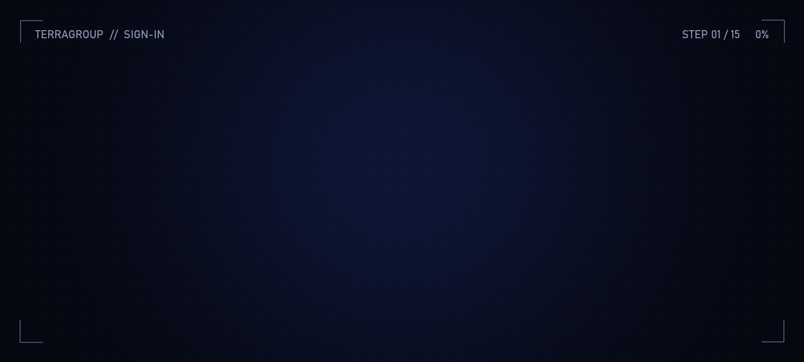
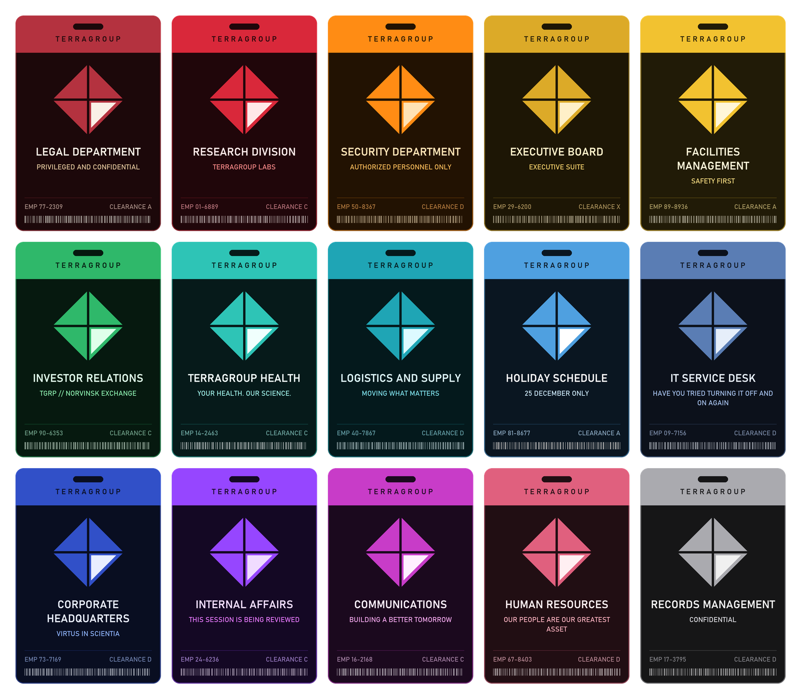

<!--
  The illustrated mod-page description. Paste everything below this comment into the listing.

  Written to answer "what does this mod do?" in the first lines: what it replaces, what you see,
  what it doesn't do. The flavour comes after that, not before.

  The Forge allows no background or styling of its own (raw HTML is stripped), so the look
  comes from images, plus Forge extras:
    - a blockquote followed by a line "{.is-info}" becomes a blue notice box;
    - "## Title {.tabset}" turns the ### headings under it into tabs, up to the next ## heading
      (there is no closing marker: a stray "{.endtabset}" shows as text), so the tabs come last;
    - a YouTube link on a line of its own embeds a player.
  Check it in the Forge editor's preview before saving. The Forge shows the word "Tarkov" as
  "T*****", so say "EFT".

  Images are served from the repository (docs/images), so they show once pushed to main.
  alt-hero-v2.webp is animated (renamed so caches drop the old, banded one) (7 s loop). Thumbnail: a square image, the Forge crops to 1:1.

  Short-description field:
    "Replaces EFT's loading screens with a TerraGroup sign-in terminal: the game's real load steps and timings, in a different department every launch."
-->

> **What this mod does:** it replaces EFT's loading screens with a TerraGroup sign-in terminal.
>
> - **When you start the game**, from the splash screen to the main menu.
> - **When you go back to the menu after a raid**, once the after-action report is done. On by default.
> - **When you load into a raid**, from pressing Ready to spawning in. Optional, off by default.
>
> The terminal shows what the game is actually loading, step by step and timed, with company memos, intel and a news ticker to read while you wait. It only changes what's on screen during loading: no gameplay changes, and loading takes as long as it always did.

{.is-info}

## What you see

- **The real load.** Fifteen steps, from verifying game files to opening the main menu, each with a live timer and a log of the finished ones. The progress bar is timed against your own previous launches, and a step that runs long is flagged.
- **A different department every launch.** Fourteen of them, shuffled so the same one doesn't come back for several launches. Each has its own colours, logo frame, background, intro, progress bar, ending and wording.
- **Five layouts**, shuffled the same way.
- **A background drawing for each department** that moves with the load: Investor Relations' share price climbs, Legal's seal presses in, Facilities' pipework speeds up, Health's heartbeat runs under the readout.
- **Things to read.** Internal memos, intel on the region (boss sightings, PMC movements, trader and flea prices) and a news and stock ticker. Nothing repeats until you've seen the rest, and some of it knows your nickname and faction.
- **Light glitches**, kept away from the moments EFT itself freezes.

## See it in action

https://www.youtube.com/watch?v=mfBwtawBhr8

## The departments

Fourteen departments, plus a holiday schedule that only appears on 25 December.

## The idea

You have a contact inside TerraGroup. Each time you start the game, your hideout's computer signs in to the company network with a borrowed employee account, and you see what that employee would see while the game loads.

## Details {.tabset}

### Install

Unzip into your SPT folder, so `ACCESSGRANTED.dll` lands in `BepInEx\plugins`. Then launch the game. Client only, no server part.

For SPT 4.1.x.

### Settings

In the F12 menu, under **ACCESS GRANTED**:

- **Theme** keeps one department, or leaves it on Random.
- **Glitches** can be Off, Subtle or Heavy.
- **Raid Loading** switches the terminal on for raid loads (off by default) and for the way back after a raid (on by default), and can show the map's name.

Tick **Advanced settings** for the rest: **Layout, Background, Logo Frame, Intro, Progress Bar, Ending** each pin one part instead of letting the department choose, and **Preview Key** changes the preview's key.

**Want a look without relaunching?** Press **Ctrl+F9** in the main menu to play the terminal over a pretend load. Left/Right changes department, Up/Down changes layout, Space re-rolls the rest, T switches between a launch and a raid load, Esc closes.

### Compatibility

- [CLASSIFIED](https://github.com/JoelHauser/CLASSIFIED): the two take turns, launch by launch, and CLASSIFIED's **With ACCESS GRANTED** setting can always show one of them instead. Raid loads and the way back go to whichever terminal you signed in to.
- [Deploy Screen Overhaul](https://github.com/JoelHauser/LoadingRaid): both replace the raid loading screen, so this terminal stands aside for raid loads by default. **With Deploy Screen Overhaul** can take turns, or always show the terminal.

### Good to know

- **Does it make loading faster?** No. It shows you what's loading and how long each step takes; the load itself is untouched.
- **Does it change gameplay?** No. It only draws over the loading screens and never takes your mouse or keyboard (except Esc to cancel a raid load, while the game allows it).
- The first launch uses rough step times. From the second launch on, the bar is timed against your own PC.
- If you set the main-menu background to Random and use a mod that adds backgrounds, this also stops the load error that combination can cause.
- If EFT shows an error while loading, the terminal gets out of the way at once.

### Uninstall

Delete `BepInEx\plugins\ACCESSGRANTED.dll`. To remove its settings and launch history too, delete the files starting with `com.mybutthasarash.accessgranted` in `BepInEx\config`.
